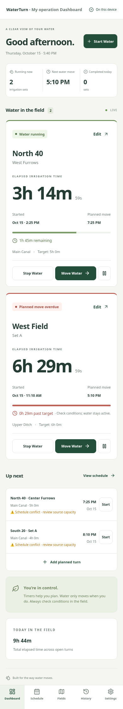
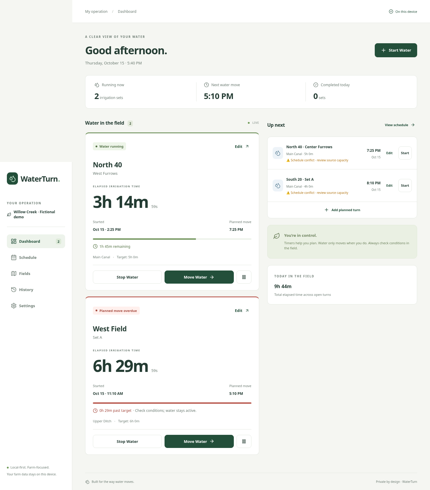

# Add WaterTurn local-first irrigation MVP

Farmers managing manual surface irrigation can record where water is running, monitor elapsed time, and move to the next set without a backend or account. The repository was empty; this change establishes a React/TypeScript/Vite application on `development/waterturn-mvp`.

Implemented:

- Responsive dashboard with active, approaching-target, overdue, and paused states; timestamp timers update every second.
- Source capacity, field/set editing and archiving, editable rotation order, optional metadata, manual start/stop/pause/resume, and atomic move operations.
- Planned turns remain separate from actual activity; timeline/week views, editable times, overlap checks, explicit capacity overrides.
- Searchable history, field/source/status/date filters, notes, daily/weekly/seasonal recorded-hour summaries, historical snapshots, set averages and transparent median suggestions.
- IndexedDB persistence, stale-tab protection, validated JSON backup replacement with preview/confirmation, CSV export.
- Offline production service worker, light/dark/system themes, opt-in browser notifications, optional fictional demo.

Screenshots:

Validation:

- `npm ci --cache /workspace/.npm-cache` successfully reproduces installation.
- `npm run build` passes TypeScript and generates a precached production app.
- `npm test`: 19 tests pass (timers, DST/overnight, sessions, conflicts, suggestions, IndexedDB, invalid import, CSV, stale writes, suggestion acceptance, storage failure feedback).
- `npm run test:e2e`: 2 Chromium browser tests pass, including create/start/move/complete/history/export/reload/offline and demo/pause/resume/import flows.
- `npm audit`: zero reported advisories, including development dependencies.

Security/privacy: farm data stays in local browser storage; no tracking, account connections, server, location permission, or API keys. Notes render as React text. Imports are validated before an atomic replacement. CSV mitigates common spreadsheet formulas. Capacity warnings require explicit confirmation. No infrastructure is physically controlled. No deployment has been performed.

Known limitations: notifications require the app to be running and are not reliable alarms. Browser data requires exported backups. Stale tabs must reload before saving. No automatic rotations, drag/drop, cross-device sync, or agronomic modeling. History includes today, rolling seven-day, and calendar-year season summaries plus custom date and set filters. Seasons use calendar years rather than custom crop-year boundaries. React Testing Library covers explicit suggestion acceptance and persistence-error feedback. Test/deployment coverage is Chromium only.

Local testing and future manual GitHub Pages deployment: see [README.md](README.md). Run `npm run dev` for development; use `npm run build && npm run preview -- --port 4173` to test production caching. Deploy only `dist/` after approval.

Initial publication: the repository originally had no remote branches. The user approved uploading this reviewed development version as the initial `main` branch. No pull request is needed for that initial upload. Future changes can use pull requests against `main`. Website deployment remains manual and has not been authorized.
