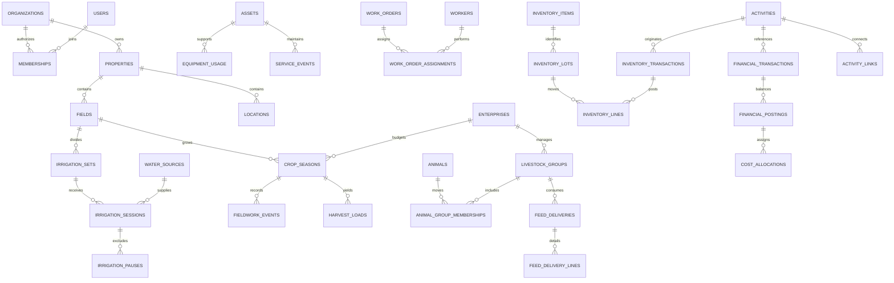

# WaterTurn FarmOS architecture

Status: long-term design, with a local pilot now implemented; see PROGRESS.md for exact delivery evidence and deviations. Living design; update decisions and migration contracts in the same review as implementation. Assessment baseline: `d57dcfd`, October 15, 2026. Preserve the existing irrigation module.

## Decisions and system boundaries

1. Retain the existing frontend stack. Extract `app/`, `shared/`, and feature directories gradually. Do not replace working irrigation calculations with a new framework or generic event engine.
2. Use one application with independently testable modules: irrigation; properties/fields/maps; crops/fieldwork; cattle; assets/maintenance; inventory; tasks; finance; reporting; administration. Modules expose commands and queries, not direct access to each other's tables.
3. Introduce a repository boundary. The initial adapter remains Dexie/local-only. A future authenticated API adapter uses PostgreSQL transactions. An identical TypeScript interface does not supply server authorization; the server validates every command again.
4. Add a Farm Activity Ledger as a shared history/projection. Operational records remain authoritative. A harvest command, inventory addition, cost reference, and activity entry share a transaction and command ID. Financial posting and activity history are separate concepts.
5. PostgreSQL is the preferred eventual system of record for connected operations: relational integrity, decimal math, transactions, row-level security, mature backups, and optional PostGIS. Defer PostGIS until field-boundary features need it. A single local prototype does not need a hosted database.
6. GitHub Pages can continue serving public application code and synthetic examples. All private multi-user records live behind authenticated services; they never enter Git, Pages artifacts, fixture snapshots, or public buckets.

Proposed layout (move features only as milestones require):

```text
src/app/                 shell, navigation, composition, local mode indicator
src/shared/domain/       identifiers, units, money, references, validation
src/shared/data/         repositories, transaction interface, local adapters
src/modules/irrigation/  existing model/screens/tests moved incrementally
src/modules/fields/      shared field/property records and optional boundaries
src/modules/tasks/       work orders and daily task queries
src/modules/activity/    activity history and search projections
src/modules/assets/     equipment and infrastructure
src/modules/inventory/  immutable posted movements and valuation
src/modules/crops/      seasons, activities, harvest
src/modules/cattle/     groups, animals, health, feed, sales
src/modules/finance/    cost postings, allocations, budgets, scenarios
src/modules/reports/    reconciled read models and exports
src/modules/admin/      settings; real memberships only with a backend
server/                 future API, authorization, jobs (not yet created)
db/migrations/          future reviewed PostgreSQL migrations (not yet created)
```

Avoid premature dependencies: no Redux, mapping provider, auth SDK, accounting engine, AI API, or paid platform is necessary for the first milestone.

## Proposed logical relational schema

This is a design specification, not executable SQL or a completed migration. Tables become physical only when their module is implemented. Use UUID internal keys for new server records. Organization-scoped tables have `organization_id`, `id`, `created_at`, `updated_at`, `version` and, where relevant, `archived_at`. Use `timestamptz` for instants; `date` for crop dates; IANA timezone for farm display/scheduling. Quantities, acreage, and money use appropriately bounded `numeric`, never binary floats for postings. Currency and unit are explicit. Financial rounding occurs at documented posting boundaries; JSON exports represent decimals as strings.

Every tenant parent has `UNIQUE(organization_id,id)`. Every tenant foreign key includes organization ID, e.g. `(organization_id,field_id) REFERENCES fields(organization_id,id)`. Index foreign keys and `(organization_id,status,due_at)` queries. No cross-organization references are permitted, including those in link tables.

| Domain / table                             | Important columns and relationships                                                                                                                                                                    |
| ------------------------------------------ | ------------------------------------------------------------------------------------------------------------------------------------------------------------------------------------------------------ |
| `organizations`                            | id, name, timezone, default_currency, status; owning tenant                                                                                                                                            |
| `users`                                    | identity subject and display name; use auth provider IDs, never app plaintext passwords                                                                                                                |
| `organization_memberships`                 | organization_id, user_id, role, status; unique membership; managed only by authorized admins                                                                                                           |
| `membership_permissions`                   | membership_id, permission_code, scope; allow limited financial scopes without copying roles into records                                                                                               |
| `workers`                                  | organization_id, optional membership_id, display_name, worker_type, active; employees/contractors can be recorded without having a login                                                               |
| `properties`                               | organization_id, name, property_type, acreage, notes                                                                                                                                                   |
| `locations`                                | property_id, kind (pasture, pen, lot, barn, bin, pit, shop, tank), name; optional geometry; also inventory/cattle locations                                                                            |
| `fields`                                   | property_id, name, acreage, irrigated_acreage, soil_notes, default_source_id, irrigation_method, notes; retain existing field identity                                                                 |
| `field_boundaries`                         | field_id, revision, geometry, area, area_unit, source, effective_from; optional validated GeoJSON initially, PostGIS later                                                                             |
| `enterprises`                              | kind (crop/cattle/other), name, reporting_year, currency; crop/cattle detail tables reference this shared financial dimension                                                                          |
| `crop_types`                               | name, intended_use, default_quantity_unit, perennial flag; configurable library                                                                                                                        |
| `crop_stands`                              | field_id, crop_type_id, establishment_date, termination_date; supports multi-year alfalfa/grass stands                                                                                                 |
| `crop_seasons`                             | field_id, crop_type_id, stand_id optional, enterprise_id, year, variety, end_use, planted_acres, planting_date, seeding_rate/unit, target_yield/unit, expected_harvest_date                            |
| `rotation_plans`                           | field_id, year, crop_type_id, scenario_id, status; future plans separate from actual crop seasons                                                                                                      |
| `water_sources`                            | name, type, max_concurrent_sets, notes; retain existing source identity                                                                                                                                |
| `irrigation_sets`                          | field_id, name, sequence_order, acreage, duration_minutes, source_override_id, archived_at                                                                                                             |
| `irrigation_sessions`                      | field_id, set_id, source_id, operator_worker_id optional, planned_start/end, actual_start/end, target_minutes, status, override flag/reason, snapshot labels                                           |
| `irrigation_pauses`                        | session_id, start_at, end_at; ordered nonoverlapping intervals                                                                                                                                         |
| `water_measurements`                       | session_id/location_id, timestamp, quantity/unit or flow/unit, method, measured_or_estimated, evidence, uncertainty notes; volume derived only with compatible measurements                            |
| `water_right_records`                      | property_id, company_contact_id, reference, shares/unit, notes; recordkeeping only, not legal adjudication                                                                                             |
| `water_right_fields`                       | right_record_id, field_id; unique pair                                                                                                                                                                 |
| `assets`                                   | property_id/location_id, category, asset_number, name, make, model, year, serial, acquired_date, purchase_cost/currency, condition, operational_status                                                 |
| `irrigation_assets`                        | asset_id, source_id optional, infrastructure_type; reuse asset register rather than duplicate pumps/headgates                                                                                          |
| `meter_readings`                           | asset_id, observed_at, meter_kind (hours/mileage), value/unit, correction_reference; reject unexplained decreasing readings                                                                            |
| `maintenance_plans`                        | asset_id, title, calendar_interval, meter_interval/unit, seasonal_window, last_service_reference                                                                                                       |
| `service_events`                           | asset_id, maintenance_plan_id optional, work_order_id optional, performed_at, symptoms, diagnosis, downtime, notes; costs reference canonical postings                                                 |
| `contacts`                                 | vendor/customer/veterinarian/etc. types, display_name, optional contact details; restricted as appropriate                                                                                             |
| `work_orders`                              | title, description, priority, status, due_at, estimated_minutes, recurrence_rule/template_id optional, completion_notes                                                                                |
| `work_order_assignments`                   | work_order_id, worker_id, assignment_role; assignee permissions evaluated server-side                                                                                                                  |
| `work_order_links`                         | work_order_id and exactly one typed field_id/group_id/asset_id; enforce references with CHECK and composite FKs                                                                                        |
| `labor_entries`                            | activity_id/work_order_id, worker_id, started_at, ended_at, minutes, rate/currency and rate-source snapshot; labor costs restricted                                                                    |
| `fieldwork_events`                         | field_id, crop_season_id, activity_type, started_at, ended_at, acres, notes; bulk command creates linked per-field entries                                                                             |
| `equipment_usage`                          | activity_id, asset_id, hours, fuel_quantity/unit, meter_reading_id, cost_posting_id optional                                                                                                           |
| `fieldwork_inputs`                         | fieldwork_event_id, inventory_lot_id, quantity/unit, application_rate/unit, inventory_transaction_id                                                                                                   |
| `chemical_applications`                    | fieldwork_event_id, product, EPA registration, treated_acres, crop/site, applicator_worker_id, certification reference, application conditions, jurisdiction/template_version                          |
| `record_requirement_templates`             | jurisdiction, record_type, version, required_fields, retention_rule; configurable, reviewed rules; not a claim of universal compliance                                                                 |
| `harvest_loads`                            | crop_season_id, fieldwork_event_id, cutting_number optional, harvested_at, quantity/unit, moisture, grade, destination_location_id, inventory_transaction_id, loss_quantity/unit                       |
| `livestock_groups`                         | enterprise_id, name, class, management_method (individual/headcount), status; avoid double-counting represented animals                                                                                |
| `animals`                                  | enterprise_id, tag, EID optional, breed, sex, born_on, birth_weight/unit, sire_id/dam_id optional, ownership, acquisition date/cost, current_status                                                    |
| `animal_group_memberships`                 | animal_id, group_id, valid_from/to; preserve movement history and prohibit overlapping active membership where required                                                                                |
| `livestock_movements`                      | animal_id or group_id, from/to_location_id, occurred_at, head_count, reason, activity_id; exactly one subject                                                                                          |
| `group_headcount_events`                   | group_id, occurred_at, quantity_delta, reason, source_reference; headcount-managed groups only                                                                                                         |
| `breeding_events`                          | animal_id/group_id, type (exposure, AI, pregnancy_check), event_date, sire_id optional, result, expected_calving_date; references validated                                                            |
| `calving_events`                           | dam_id, calf_id, calved_at, difficulty, birth_weight/unit, notes                                                                                                                                       |
| `weaning_events`                           | animal_id/group_id, event_date, head_count, weight/unit, notes                                                                                                                                         |
| `animal_weights`                           | animal_id or group_id, observed_at, quantity/unit, head_count if group, measurement_method                                                                                                             |
| `treatments`                               | animal_id or group_id, product/medication, dosage/unit, route, treated_at, worker_id, veterinarian_contact_id, withdrawal_until, verified_by, activity_id; no automatic safe-for-slaughter declaration |
| `rations` / `ration_ingredients`           | group/class, revision; ingredient item_id, quantity/unit, basis (as-fed/dry-matter), dry_matter_fraction when known                                                                                    |
| `feed_deliveries`                          | group_id, fed_at, ration_revision_id, head_count_snapshot, activity_id                                                                                                                                 |
| `feed_delivery_lines`                      | delivery_id, lot_id, quantity/unit, dry_matter_fraction optional, inventory_transaction_id, valuation_reference                                                                                        |
| `livestock_sales` / `livestock_sale_lines` | buyer, date, animal/group references, head_count, weight/unit, price/basis, commission, freight, shrink, financial_transaction_id                                                                      |
| `beef_orders` / `processing_events`        | customer_id, animal_id, fraction, deposit/balance references, processor_id, appointment, hanging weight, yield, customer_pays_processor; later optional module                                         |
| `inventory_items`                          | category, name, base_unit, low_stock_threshold, valuation_method; distinguish units by physical dimension                                                                                              |
| `inventory_lots`                           | item_id, origin (purchased/produced), harvest/purchase reference, received_date, expiry_date, moisture/quality, cost_layer_reference                                                                   |
| `inventory_transactions`                   | activity_id, type, occurred_at, status, command_id; immutable after posting; correction by reversal                                                                                                    |
| `inventory_lines`                          | transaction_id, item_id, lot_id, location_id, signed_quantity, unit, unit_cost_snapshot, currency, cost_layer_id; paired movements for internal location transfer                                      |
| `inventory_cost_layers`                    | lot_id, originating_posting_id, quantity, remaining_quantity, unit_cost, valuation_method/version; FIFO by lot initially                                                                               |
| `financial_transactions`                   | occurred_on, description, category_id, contact_id, kind, currency, payment_status, source_activity_id; separates cash events from operational cost recognition                                         |
| `financial_postings`                       | transaction_id, account_id, debit/credit decimal, currency, enterprise/field/group/asset dimensions; balanced journal, immutable when posted                                                           |
| `cost_allocations`                         | source_posting_id, destination dimension, amount, basis (acres/hours/head-days/manual), basis_quantity, rule_version; totals cannot exceed source cost                                                 |
| `budgets` / `budget_lines`                 | enterprise_id, year, version, category_id, planned_amount, quantity/unit, assumption references                                                                                                        |
| `scenarios` / `scenario_assumptions`       | base_snapshot_id, name, price/yield/cost overrides; modeled outputs never alter actual postings                                                                                                        |
| `activities`                               | type, occurred_at, actor_worker_id, command_id, correlation_id, summary, recorded_at; immutable Farm Activity Ledger entry                                                                             |
| `activity_links`                           | activity_id and exactly one typed field/season/animal/group/asset/task/inventory/financial record FK; no unchecked polymorphic IDs                                                                     |
| `attachments` / `attachment_links`         | private object key, content type/size/hash, owner/uploader; typed parent references with permission checks; never public file URLs                                                                     |
| `audit_events`                             | actor_user_id, organization_id, command_id, action, affected table/id, prior/new version, timestamp, minimal redacted changes; append-only via trusted code                                            |
| `legacy_id_maps`                           | import_batch_id, entity_type, legacy_id, new_id; retain original string IDs and provenance                                                                                                             |
| `import_batches`                           | schema_version, input_hash, tenant, record counts, validation/reconciliation results, status, started/completed_at                                                                                     |
| `command_receipts`                         | organization_id, command_id, actor_id, request_hash, result_reference; unique ID supports safe retries without duplicate posting                                                                       |
| `sync_changes` / `record_tombstones`       | server cursor, entity/version, committed_at, delete/archive markers; scoped change feed, added only with synchronization                                                                               |

## Relationship overview



For readability the diagram omits many columns and tenant links. The table contract above still requires organization scope and composite FKs on every tenant relation.

## Invariants and command boundaries

- One open irrigation session per set: partial unique index on organization/set for active or paused. Capacity uses active sessions; source-scoped transaction locks prevent concurrent starts/resumes bypassing limits. Move closes and starts in one transaction. Planned conflicts warn; no timer starts/stops water.
- Session start/end ordering and pause validity must be enforced centrally and with database checks/triggers where cross-row constraints require them. Store explicit planned and actual timestamps; do not infer actual water use from a plan.
- Commands include organization, actor, idempotency key, expected record version, and payload. Validate tenant membership and all references before writes. Lock shared capacity/inventory resources in consistent order.
- Inventory balances derive from posted movements. No silent overwrite of on-hand. Matching transfer lines sum to zero quantity across locations. Prevent negative inventory by default; documented authorized adjustments are separate events.
- Costs have one canonical originating posting. Allocations describe distribution and never duplicate the originating cash expense. Financial reports reconcile posting/valuation IDs, not sums of every module's displayed cost.
- New module entities reference shared fields/workers/assets. Do not duplicate a tractor in fieldwork or a field in irrigation. Attachments and activity links use typed validated references.
- Cost-based FIFO by lot is the initial valuation proposal. Store quantity and basis in a compatible base unit; no automatic bushel/ton or as-fed/dry-matter conversions without commodity density/moisture assumptions and rule version.

### Crop-to-feed example: no fictitious revenue

A fictional 200-ton silage harvest carries $10,000 of accumulated attributable production cost. Capitalize that cost into a lot at $50/ton; do not leave it simultaneously recognized as a second farm-wide expense. Feeding 10 tons reduces that lot by 10 tons/$500 and transfers $500 into the cattle enterprise's feed cost or work-in-process under the chosen reporting policy. The remaining lot is 190 tons/$9,500. Internal transfers create no cash receipt and no external sales revenue. Crop production-cost reports may show the $10,000 incurred while consolidated profit recognizes cost only once according to the documented recognition policy. A management market-value scenario is separate from the cost ledger and eliminated from consolidated totals. Accountant-reviewed cash/accrual policies and test reconciliations are required before financial release.

Labor and equipment estimates also stay distinct from actual ledger costs. If a repair invoice was already posted, an equipment allocation references its cost pool; it does not post the invoice again. Over/under-allocation is visible, never hidden in rounding.

## Authentication, permissions, and privacy

Local demonstration mode has **no authentication or security roles**. An organization ID in IndexedDB is a future migration boundary, not secure isolation from another person using the browser. Use synthetic data for the FarmOS experiment. Do not claim pending sync or synchronized while no server exists.

Before private multi-user access, use a maintained authentication provider with secure sessions and PostgreSQL-backed authorization. Choose a deployment/auth path only after comparing the options below. Enforce permissions for list/search/read/write/export/attachments and command endpoints, not only navigation. JWT identity is verified server-side; organization membership is looked up and checked on each request. Never trust a client-supplied role or tenant claim alone. PostgreSQL RLS is defense in depth; application roles do not get BYPASSRLS/service-role credentials. Restrict function execution, fix security-definer search paths, and prevent owner-role membership escalation.

| Role              | Proposed server-enforced access                                                                                  |
| ----------------- | ---------------------------------------------------------------------------------------------------------------- |
| Owner/admin       | Organization administration and all authorized business records; sensitive actions audited                       |
| Manager           | Operational modules; financial scopes explicitly granted, not automatically implied                              |
| Employee/operator | Assigned tasks and necessary operational records; no default owner/financial/valuation/document access           |
| Accountant        | Financial reporting/postings and necessary linked cost facts; no membership administration or gate/work dispatch |
| Read-only         | Explicit permitted report datasets only; no writes, no automatic access to every module                          |

Financial rows, payroll/rates, acquisition/valuation amounts, contacts, and private attachments require permission-aware endpoints/views and exports. Row policies alone do not hide sensitive columns from an otherwise permitted employee. Use separate restricted tables or carefully scoped views/API projections. New tenants deny access by default.

Release security tests must use two organizations, all roles, unauthenticated/expired/revoked sessions, direct IDs, cross-tenant FKs, bulk/export/search endpoints, object downloads, realtime subscriptions, and attempted self-promotion. Audit logs are server-written and immutable to ordinary clients. Backups need encryption/access controls, documented retention, deletion handling, and tested restore. No raw production fixtures in CI.

## Migration and offline strategy

1. Preserve current origin, database name, IDs, version-1 JSON export/import, and application usability. Adding farm metadata must not reset irrigation state. Do not silently seed over a nonempty farm.
2. For the first milestone, extend the local document additively with a version-2 schema, explicit migration function, organization/property/task/activity sections, and retained legacy irrigation structures. This is a transitional single-user adapter, not the final relational server implementation. Reject stale version-1 clients from writing version-2 data.
3. Before migration, offer a downloadable original backup and verify persistent backup creation; if storage/quota fails, abort without changing the old record. Validate into a staging object, then write a new version atomically. An old cached client should show an upgrade/export message rather than hang or reset records. Test downgrade recovery with the untouched backup.
4. Preserve ID strings locally. On a later PostgreSQL import, map arbitrary legacy IDs to UUIDs through an import batch, rewrite every reference consistently, retain original snapshots and timestamps, and never auto-merge different devices' backups by matching names.
5. Reconcile entity counts, completed/active/planned statuses, pause intervals, total elapsed durations at a fixed instant, archive flags, labels, and all existing notes. Require user preview/confirmation. Failed validation/import rolls back the entire batch.
6. Backend adoption is explicit: export local records, authenticate to a chosen organization, preview import, commit idempotently, compare results, and retain the local backup. A cloud import is opt-in data transmission, not a background migration.
7. Offline synchronization is a later feature with versioned local records, outbox commands, server cursors/tombstones, idempotent receipts, and explicit conflicts. States are saved locally, pending sync, synchronized, or conflict. Last-write-wins is unsuitable for inventory, finance, cattle movement, or competing water starts.
8. Authorize offline writes again on sync; revoked access must not silently upload changes. Partition caches by user/organization, purge on logout as appropriate, and define shared-device safeguards. Sensitive offline caching is an explicit policy choice. Offline start/move may require operator reconciliation if another device already allocated the source; never imply a physical change was undone automatically.

## Hosting/auth options and cost envelope

Estimates are planning ranges in USD per month, not verified vendor quotes or current plan guarantees. No services have been provisioned. Verify then-current terms, quotas, region, backup retention, egress, and commercial-use eligibility before choosing a provider.

| Path                                                             | Suitability                                          | Planning cost / tradeoffs                                                                                                                                                                                                                                                                                         |
| ---------------------------------------------------------------- | ---------------------------------------------------- | ----------------------------------------------------------------------------------------------------------------------------------------------------------------------------------------------------------------------------------------------------------------------------------------------------------------- |
| Current Pages + local Dexie                                      | Recommended synthetic single-device foundation       | Hosting may remain $0 where the repository/account plan allows Pages. No database/auth bill. No durable shared data, remote roles, or sync. Optional domain often roughly $10–25/year.                                                                                                                            |
| Pages frontend + managed PostgreSQL/auth/storage (e.g. Supabase) | Candidate for a controlled private multi-user pilot  | Free tiers may support disposable synthetic trials, with limits/pausing and no assumed backup SLA. Budget roughly $25–75/month for a modest paid pilot plus possible storage/egress/backups. RLS, private buckets, and command transactions still require engineering. Auth/storage APIs increase migration work. |
| Static frontend + small API + managed PostgreSQL + separate auth | Strong portability and explicit domain command layer | Rough planning $20–100+/month across API, database, auth, storage and backups at low usage. More integration/operations work; avoids tying domain code to a single data API.                                                                                                                                      |
| Self-hosted API/PostgreSQL/auth                                  | Consider only with someone owning maintenance        | A small VM may cost roughly $10–40/month before independent backups/monitoring and labor. Security updates, certificates, restore, availability, and on-call time can outweigh savings.                                                                                                                           |

Recommendation: stay on the free/local path for the first agreed milestone. At the backend gate, compare managed PostgreSQL/auth against an API-plus-managed-PostgreSQL pilot with real usage, recovery requirements, and operator capacity. PostgreSQL schema/exports and a domain-command boundary preserve portability. Do not add bank connections, external AI, weather providers, paid imagery, or employee invitations during this phase.

## Navigation and dashboard concept

Desktop sidebar: Dashboard; Maps & Fields; Irrigation; Crops & Fieldwork; Cattle; Equipment & Maintenance; Inventory; Tasks & Scheduling; Finances & Profitability; Reports & Analytics; Administration. Show only implemented destinations as actionable. Future areas may be listed in an explicitly labeled roadmap, not as empty working modules.

Mobile: Home, Irrigation, Tasks, Fields, More; More contains remaining implemented modules and Administration. Preserve a prominent Start Water within Irrigation and a global Quick Add that lists only working actions. Keep existing irrigation Schedule/History/Settings reachable inside the irrigation area. Use browser-safe hash routes initially if persistent deep links are introduced on Pages; no server rewrite requirement.

Proposed initial home layout:

```text
WaterTurn FarmOS                 Saved on this device
One operation. Every acre. Every animal. Every dollar.
[Search implemented records…]       [+ Quick Add]
TODAY · farm-local date
[Running irrigation] [Next move] [Open tasks] [Operated acres]
ATTENTION NOW
  Irrigation moves approaching / overdue (manual control)
  Tasks due today / overdue, with named assignee labels
TODAY'S WORK
  Irrigation turns + task list, with source module links
RECENT FARM ACTIVITY
  Field setup · task completion · linked irrigation event
```

Never show fabricated financial totals, cattle counts, forecasts, or live weather. Not-configured modules show no-data/configuration guidance only when implemented. Current device settings remain device preferences; future farm timezone is explicit. Initial search includes fields, water sources, tasks, and irrigation references; cattle/equipment become searchable when those records exist. Widget ordering can be stored locally; role-based widget choices come only with real server permissions.

## Local pilot implementation delta

The user selected a no-paid-services local PostgreSQL/API setup. The frontend retains the original irrigation code and adds `src/farmos` modules. The operational domain is split under `src/farmos/modules/` into typed models, primitives, crops, cattle, inventory, assets, ledger and validation. IndexedDB physical schema version 3 stores the current version-2 farm document, legacy backups and explicit pending-sync metadata. It does not pretend to be secure multi-user browser storage.

`db/migrations` implements organization-scoped entity JSONB records, composite relational links, canonical typed financial posting tables, balanced-journal constraints, authenticated memberships/scopes, hashed-password/session records, command receipts, immutable command audit and per-record version/hash audit. This is a transitional relational pilot, not a physical implementation of every logical table above. The API uses a non-superuser role without RLS bypass. API role checks control data projections; SQL tenant isolation is additional defense, not a substitute for those checks.

Manual owner snapshots are explicit, revision-checked and idempotent. An explicit empty-destination import remaps organization ownership while retaining record IDs and timestamps. Nonempty organization merging is rejected. Assigned employee tasks and scoped accounting/read-only reports are served through the authenticated API. Offline per-record/multi-user merging, shared-device cache isolation, production identity recovery, MFA and hosting operations remain release gates before real private deployment.

Default insights are deterministic and read-only. `integrations.ts` defines a provider-neutral, scope/destination/consent-gated context preparation boundary without network transport or credentials. No external AI, bank, weather or equipment service is connected.
