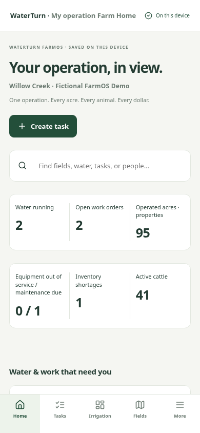
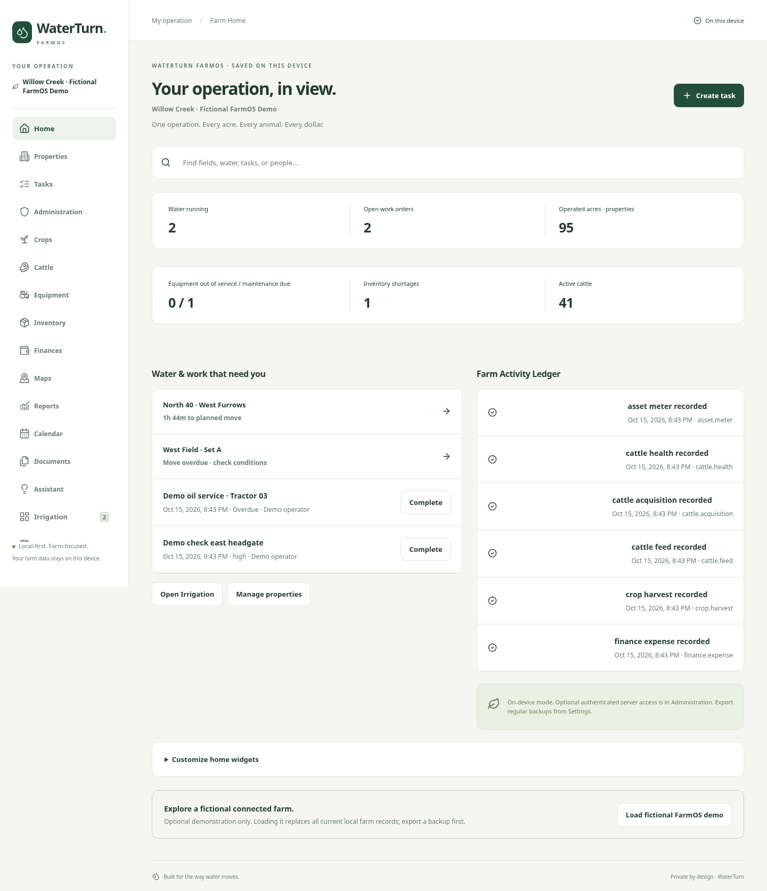

# Review: WaterTurn FarmOS local development pilot

This branch extends the existing WaterTurn app into connected farm operations while preserving manual irrigation behavior and existing records. It contains the Phase 0 assessment and implementations spanning the locally testable Phase 1–7 workflows. It is **not the entire long-term product brief or a production multi-user release**. See [phase-by-phase reviews](PROGRESS.md) for exact scope, evidence and adaptations.

## Try it

Run `npm ci`, `npm run build`, then `npm run preview -- --port 4173`. Farm Home offers **Load fictional FarmOS demo**, which requires confirmation and replaces local farm records. The connected demo includes fields, irrigation, people/task labels, crop production cost, harvested inventory, cattle feed transfer, weights/treatment restrictions and equipment maintenance. No account, API key or real farm data is needed.

Mobile uses Home/Tasks/Irrigation/Fields plus More; desktop has the module sidebar. Widgets are configurable. Optional API access is separate from local mode and requires local setup and a user-chosen password—there is no default account.

## Main changes

- Additive legacy migration with an exact original backup; version-1 imports remain supported. Source/field/set/session IDs, snapshots and timestamps are preserved. Physical IndexedDB upgrade and failed-migration rollback are tested.
- Farm/property/shared-field records, worker labels, tasks/recurrence/completion, weekly/combined calendars, global search and activity history.
- Crop seasons, configurable crop entry, rotation history, fieldwork and chemical records, bulk allocations, harvest/cuttings and cost-based inventory integration.
- Cattle groups/individuals, staged CSV import, profile corrections, weights/ADG, reproduction/health, explicit withdrawal warnings, feed/recipes, individual/headcount sales, enterprise movements and carrying costs; optional beef reservation information.
- Equipment/meter history and explicit corrections, maintenance/service/recurrence and work-order links; inventory FIFO lots, immutable movements, transfers, losses and shortages.
- Integer-cent financial journals, budgets, allocations/reversals, inventory/WIP/cash distinction, cost/unit metrics and scenarios. Crop-to-feed transfers create no fictitious revenue.
- Local field sketches/GeoJSON, linked attachments, CSV/printable reports and deterministic read-only insights/recorded-use projections. External integration preparation is disabled unless scope/destination/sharing consent is supplied; no provider transport is connected.
- Optional loopback PostgreSQL/API with organization isolation, five server roles, scoped financial access, member administration, CSRF/origin/revocation controls, idempotent commands, immutable command/record audit and SQL financial-balance checks.
- Manual owner snapshot queue/sync, conflict preservation/reconciliation, and explicit migration into an empty authenticated server organization; employee assigned tasks and restricted reports.

## Verification

- Production build and frontend/server TypeScript checks pass.
- 49 unit/component/domain/migration/export tests pass.
- 11 direct API/PostgreSQL security/restore/setup tests pass.
- 8 Chromium browser workflows pass, including original irrigation, physical legacy upgrade, full demo/widgets, connected operations, maps/attachments, offline reload and competing-owner sync conflict.
- A real PostgreSQL dump is restored into an isolated temporary database and checked.
- CSV exports are parsed back in tests; spreadsheet formula prefixes are mitigated. Attachments download with content-type-appropriate safe extensions.
- No coverage percentage or cross-browser/private-production certification is claimed.

Screenshots are fictional demonstration data:

## Security, privacy and limits

No real farm, bank, employee or livestock information is in the source or build. Runtime credentials and bootstrap administration credentials are separated in ignored local files. Static Pages artifacts contain no database connection settings. No external AI/weather/bank/map service is connected and no paid infrastructure is provisioned.

Default local mode is intentionally unauthenticated. Imported owner data stays in that browser after API logout; it is not a secure shared-device cache. Keep this pilot synthetic. Before real private deployment, address cache partition/purge policy, automatic per-record multi-user synchronization, recovery/MFA, independent security/accounting review, retention policies and public HTTPS/backend operations. The PostgreSQL pilot is entity JSONB plus relational links/financial posting tables, not every physical table in the long-term design. Chemical rules are jurisdiction notes rather than a completed compliance/retention engine. Beef reservations are informational, not a full receivables/deposit subledger. Future optional integrations still require specific provider/data-sharing/cost decisions.

Nothing was merged to main or deployed. The existing Pages workflow remains manual. [README.md](../../README.md) documents local setup, API user creation, tests, backup/restore and future deployment boundaries.
